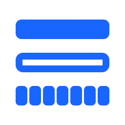

# Omi Esoteric Languages



Programs in esoteric languages that read common binary exchange protocols, generated from the same compiled data models every other Omi repository is generated from.

## Languages

One directory per language. Each has a readme of its own: what its programs are, how to run them, and what they were held to before they were published.

| Language | Directory | Programs | Checked by |
| --- | --- | --- | --- |
| [Brainfuck](brainfuck/ReadMe.md "Brainfuck ReadMe") | `brainfuck/` | `.bf` | `python3 check.py` runs every program on every frame published for it |
| [Emojicode](emojicode/ReadMe.md "Emojicode ReadMe") | `emojicode/` | `.emojic` | `python3 replay.py` compiles every program and runs it on every frame, and needs the compiler |

## Why

Every other generated language lends its generator something: arithmetic, addressing, variables, functions. A language that lends nothing leaves the generator nowhere to hide a gap, so whatever cannot be expressed in it is a gap in the protocol model rather than in the language. These programs are a conformance test of the models as much as they are code.

They are also slow, by some six orders of magnitude against the generated C++. This is a demonstration and a test, not something to run a venue on.

## Running

The scripts sit here at the root and are run from here, so a path given to any of them starts with the directory of the language it is in. `check.py` and `replay.py` are what the build runs, between them holding every program here to the frames published beside it. `run.py` puts a stream of a venue's own orders to one of the published markets and reads back what it wrote, field by field.

`demo.py` is the one to start with. It plays a run through every program of a venue - a client's packets into the gateway, the venue's own orders into the market, market data out of each feed, and the client's answers out of the responder - and says what each read and wrote, with the book drawn as it changes:

```
python3 demo.py              the venues here, and the runs each can be shown by
python3 demo.py NsmEquities     that venue's day, through every one of its programs
```
What a language's programs read, what they write when they read it, and the exact commands that run them are in that language's own readme, written from this directory.

## Testing

[](https://github.com/Open-Markets-Initiative/omi-esoteric-languages/actions/workflows/build.yml)

Please report any parsing errors as an [issue](https://github.com/Open-Markets-Initiative/omi-esoteric-languages/issues "Omi Esoteric Issues"). Include the bytes the program was given and what it wrote, beside what the protocol says it should have.

## Development

Updates are greatly appreciated; however, this entire repository is source generated...including the words you are reading right now. If you wish to suggest updates, the recommended process is to create an issue with changes and explanation. Time permitting, we will update the models and regenerate.

What the generator said as it wrote this repository is kept beside the build, in `.github/logs/generate.log`: every program it could not publish and why, every run it could not prove, and every decision a program records about itself. Its history is the history of what could and could not be generated here.

## Open Markets Initiative

[](https://github.com/Open-Markets-Initiative/Directory)  The Open Markets Initiative (Omi) is a group of technologists dedicated to enhancing the stability of electronic financial markets using modern development methods.

Other generated code can be found at [Omi Repositories](https://github.com/Open-Markets-Initiative/Directory/tree/main/Repositories "Open Markets Initiative Repositories"); for Omi rules and regulations, see [Omi Directory](https://github.com/Open-Markets-Initiative/Directory "Open Markets Initiative Directory").
## Disclaimer

Any similarities between existing people, places and/or protocols is purely incidental.

Enjoy.

