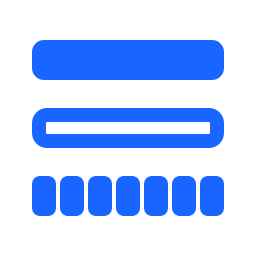
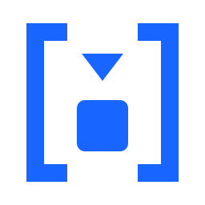

# Omi Esoteric Languages



Programs in esoteric languages that read common binary exchange protocols, generated from the same compiled data models every other Omi repository is generated from.

## Languages

One directory per language, and a readme in each saying what that language's programs are, how to run them, and what they were held to before they were published:

| Language | Directory | What it lends the generator |
| --- | --- | --- |
| <a href="brainfuck/ReadMe.md"></a> [Brainfuck](brainfuck/ReadMe.md "Brainfuck ReadMe") | `brainfuck` | Nothing: eight instructions and one tape of bytes |
| [🏁 🍇 🍉](emojicode/ReadMe.md "Emojicode ReadMe") [Emojicode](emojicode/ReadMe.md "Emojicode ReadMe") | `emojicode` | Variables, arithmetic and a loop that takes a condition - over bytes that are signed |

A second language is a sibling directory rather than a second repository, because what differs between them is a directory and not a protocol. The models are the same and the venues are the same, and every language's programs are held to the same claim before they are published: what one decodes must agree with what the C# parser decodes from the same bytes, and what one encodes must parse back.

**Each directory stands on its own.** A language lays its own frames, because a frame is laid for a reader rather than for a protocol and no two of these read quite the same parts of a model; it publishes them beside its own programs, with what each program should write for them; and nothing in one language's directory was checked against another's output. Where two of them happen to read the same bytes into the same fields, what they agree on is the model.

## Why

Every other generated language lends its generator something: arithmetic, addressing, variables, functions. A language that lends nothing leaves the generator nowhere to hide a gap, so whatever cannot be expressed in it is a gap in the protocol model rather than in the language. These programs are a conformance test of the models as much as they are code.

They are also slow, by some six orders of magnitude against the generated C++. This is a demonstration and a test, not something to run a venue on.

## Layout

The same in every language, so that knowing one directory is knowing the other:

```
manifest.json                         every program, its runs, and how a venue's programs join
<language>/ReadMe.md                  the language: how its programs are run
<language>/protocols/<path>/          one decoder per protocol, wherever it is spoken
<language>/exchanges/<venue>/         one venue's own programs, and a readme saying what each is
    <Venue>.Gateway.<ext>             order entry in, the venue's own orders out
    <Venue>.Market.<ext>              the venue's own orders in, its own events out
    <Venue>.<Feed>.Feed.<ext>         the venue's own events in, market data out
    <Venue>.<Session>.<ext>           the order entry's handshake
    <Program>.<run>.frame             the bytes one run gives a program, as hexadecimal
    <Program>.<run>.wrote             the bytes it should write for them
```
**A venue is more than one program, and they join.** What a gateway writes is what its market reads, and what a market writes is what each of its feeds reads. Where a run was carried through, the `.wrote` of one program and the `.frame` of the next hold the same bytes, and a venue's readme gives the lines that run them joined.

**Nothing has to take a file's name apart.** `manifest.json` lists every program with the language it is in, what kind of program it is, the venue it belongs to, the protocol it reads and the one it writes, and each of its runs as the two files that hold it. It lists every join as the two files that must be the same. It is written by the run that writes everything else, and `check.py` holds it to the files: everything it lists is here, everything here is listed, and every join it states is true byte for byte.

## Running

The scripts sit here at the root and are run from here, so a path given to any of them starts with the directory of the language it is in. `check.py` and `replay.py` are what the build runs, between them holding every program here to the frames published beside it. `run.py` puts a stream of a venue's own orders to one of the published markets and reads back what it wrote, field by field.

What a language's programs read, what they write when they read it, and the exact commands that run them are in that language's own readme, written from this directory.

## Testing

[](https://github.com/Open-Markets-Initiative/omi-esoteric-languages/actions/workflows/build.yml)

`python3 check.py` runs over every program in the repository, and holds each to being a program at all — for one language a loop opened is a loop closed, for another a block opened is a block closed.

**How much more than that it can say depends on the language, and the difference is worth keeping straight.** Where the script can carry an interpreter — eight instructions fit in two hundred lines — a program is run on each frame published beside it and held to writing what its `.wrote` file records. Where running one needs a compiler, no script can be the runtime; `check.py` holds only that the evidence is whole, every frame having the output it should produce beside it.

`python3 replay.py` is the other half, and it is where that second kind of program is actually run. It installs nothing: it finds the compiler on the path or takes it from an environment variable, builds each program, and runs it on every frame published beside it. The build installs the compiler and passes `--required`, so a toolchain that failed to install fails the build rather than quietly replaying nothing. Without a compiler it says what it would have run and stops.

Either way it is a regression gate rather than a proof. What makes a recorded output worth anything is that it was held against the C# parser reading the same bytes through the same model — field for field, in order, and accounting for every byte — before it was published. That comparison cannot be made here, because neither the models nor the parser are in this repository, so what the script says is that nothing has changed since. Each language's own readme says exactly what stands behind its programs.

Please report any parsing errors as an [issue](https://github.com/Open-Markets-Initiative/omi-esoteric-languages/issues "Omi Esoteric Issues"). Include the bytes the program was given and what it wrote, beside what the protocol says it should have.

## Development

Updates are greatly appreciated; however, this entire repository is source generated...including the words you are reading right now. If you wish to suggest updates, the recommended process is to create an issue with changes and explanation. Time permitting, we will update the models and regenerate.

## Open Markets Initiative

[](https://github.com/Open-Markets-Initiative/Directory)  The Open Markets Initiative (Omi) is a group of technologists dedicated to enhancing the stability of electronic financial markets using modern development methods.

Other generated code can be found at [Omi Repositories](https://github.com/Open-Markets-Initiative/Directory/tree/main/Repositories "Open Markets Initiative Repositories"); for Omi rules and regulations, see [Omi Directory](https://github.com/Open-Markets-Initiative/Directory "Open Markets Initiative Directory").
## Disclaimer

Any similarities between existing people, places and/or protocols is purely incidental.

Enjoy.

