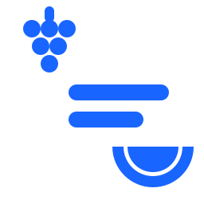

# Emojicode



Programs in Emojicode that read common binary exchange protocols, generated from the same compiled data models every other Omi repository is generated from.

## Why

A generator that only ever targets languages built for the job is never told when its model is incomplete. Emojicode will do arithmetic and hold a variable and take a slice of bytes, and it will not do a single thing a protocol expects: there is no struct, no cast, no pointer into a buffer, and a byte is signed. What survives that is a reading expressed in the model's own terms rather than in a language's.

These are also slow, and that is not the point of them. This is a demonstration and a test, not something to run a venue on.

One thing is worth saying about the company it keeps. This repository publishes the same protocols in more than one esoteric language, each generated independently and each holding its own frames; where two of them read the same bytes into the same fields, what they agree on is the model rather than either language. Nothing in this directory depends on another, and nothing here was checked against another's output.

## Usage

A program is compiled first, and then takes **two arguments**: the frame to read, and the file to write. Emojicode 1.0 beta 2 has no standard input — the file package is the only way in or out — so the paths are arguments rather than a pipe.

```
emojicodec emojicode/protocols/nasdaq/nsmequities/orders/NsmEquities.Orders.v5.0.Client.emojic
./NsmEquities.Orders.v5.0.Client frame.bin wrote.bin
```
What it writes is a line per field: the field's own name, an equals, then the bytes that field held. Which message it was is said by the order the lines come in, because only one arm of a dispatch ever runs. Padding is read and not reported.

Most programs have a frame published beside them, as hexadecimal in a `.frame` file, with what the program should write for it in a `.wrote` file. Those are the shortest way to see one of these work:

```
./NsmEquities.Orders.v5.0.Client frame.bin wrote.bin
cmp wrote.bin expected.bin
```
**One compiler, and no dialect to choose between.** Emojicode 1.0 beta 2 is the only implementation, its last release was February 2020 and the last commit to the project was August 2023, so a program here is correct against that build rather than against a standard. There is nothing to ask an implementation about, because there is no second one to disagree with it.

## The language, where it bites

Two things about Emojicode shape every program here, and both were found by compiling and running rather than by reading the reference.

**A byte is signed.** Converting `0xFF` gives -1 rather than 255, and a two byte little endian field of `FF FF` reads as -257 rather than 65535. Every place a generated program turns a byte into a number it masks it first, and that masking is not decoration.

**Binary data can be built from a string or from raw memory, and from nothing else.** That matters wherever a protocol packs several fields into bytes none of them owns: such a field's value is worked out rather than cut out of the frame, and there is no way to turn a number into the byte it stands for. A string will not do it — data made from one is that string's utf8, so a byte above 127 comes out as two, and `0xC0`, `0xC1` and `0xF5` through `0xFF` are not the encoding of anything and cannot be written at any length. So a program that reads packed fields builds every byte there is, once, in a `☣️` block at the top, and afterwards cuts the byte it wants out of that like any other slice. A dozen lines in one place, and nothing the rest of the program does.

## Layout

Where these sit, written from the repository root rather than from here, because the root is where the script that checks them is:

```
emojicode/
  protocols/<organization>/<division>/<protocol>/<protocol>.emojic
  protocols/<organization>/<division>/<protocol>/<protocol>.<message>.frame
  protocols/<organization>/<division>/<protocol>/<protocol>.<message>.wrote
```
Protocol decoders, and the frames that prove them. A decoder is the same program whoever speaks the protocol, so it is filed under the protocol rather than under a venue. A model stating more than one framing — a client's stream and a server's are different programs, because they read different bytes — writes one file for each.

## Testing

[](https://github.com/Open-Markets-Initiative/omi-esoteric-languages/actions/workflows/build.yml)

**What a published frame here is worth, stated exactly, because the obvious reading of it is too generous.**

Each frame is laid out from the model for these programs — not for a reader in general, which is not a thing: one language acts on a rule stating a record's size and another does not, so a frame that proves one proves nothing about the other. Captures the corpus holds for a protocol are offered too, and those are bytes an exchange really sent.

A frame is then published only where two independent readings of it agree. The C# parser must read the bytes through the model and account for every one. A second reading, walking the same model over the same bytes, must report the same fields, by the same names, in the same order, and consume the frame exactly. Where they part company the frame is not published and the reason is reported instead — so a wrong frame cannot ship, only a missing one. The `.wrote` published beside a frame is what that second reading produced.

**What this does not say is that the program was run.** Nothing in the process that writes these programs can run one: there is no Emojicode interpreter to carry, only a compiler, and it is not there. So the reading the frame was held to and the program written from the same model are two readings by one author, and their agreeing with each other would prove little. What carries the weight is the parser — other people's code, reading the same bytes by its own route — and what settles the rest is compiling the program and running it on the frames published beside it, which is done where the compiler is rather than here.

`python3 check.py` therefore makes a smaller claim about these than it makes about a language it can interpret. Every file here is held to being a program at all — a block opened is a block closed — and every frame is held to having its recorded output beside it, because a frame nothing can ever check is not evidence. It does not run them: that needs `emojicodec`, and a program needing a 56 megabyte compiler cannot be checked by a script that carries its own interpreter in two hundred lines.

**`python3 replay.py` is where they are actually run**, and it is what this repository's own build does on every push. It finds `emojicodec` on the path or takes it from the environment, compiles each program here, and runs it on every frame published beside it, holding what it writes to what the `.wrote` file records. So the claim above — that the compiled program reproduces these frames — is one this repository makes on itself rather than one a reader has to take on trust:

```
export EMOJICODEC=/path/to/emojicodec
python3 replay.py
```
Please report any parsing errors as an [issue](https://github.com/Open-Markets-Initiative/omi-esoteric-languages/issues "Omi Esoteric Issues"). Include the bytes the program was given and what it wrote, beside what the protocol says it should have.

## Development

Updates are greatly appreciated; however, this entire repository is source generated...including the words you are reading right now. If you wish to suggest updates, the recommended process is to create an issue with changes and explanation. Time permitting, we will update the models and regenerate.

| Programs | Characters | Reading every field the model states | Frames | Recorded from the wire |
| --- | --- | --- | --- | --- |
| 16 | 502,704 | 16 of 16 | 160 | 50 |

## Open Markets Initiative

Other generated code can be found at [Omi Repositories](https://github.com/Open-Markets-Initiative/Directory/tree/main/Repositories "Open Markets Initiative Repositories"); for Omi rules and regulations, see [Omi Directory](https://github.com/Open-Markets-Initiative/Directory "Open Markets Initiative Directory").
## Disclaimer

Any similarities between existing people, places and/or protocols is purely incidental.

Enjoy.

